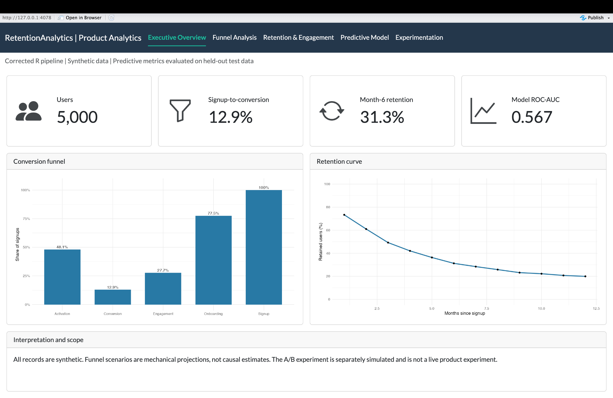
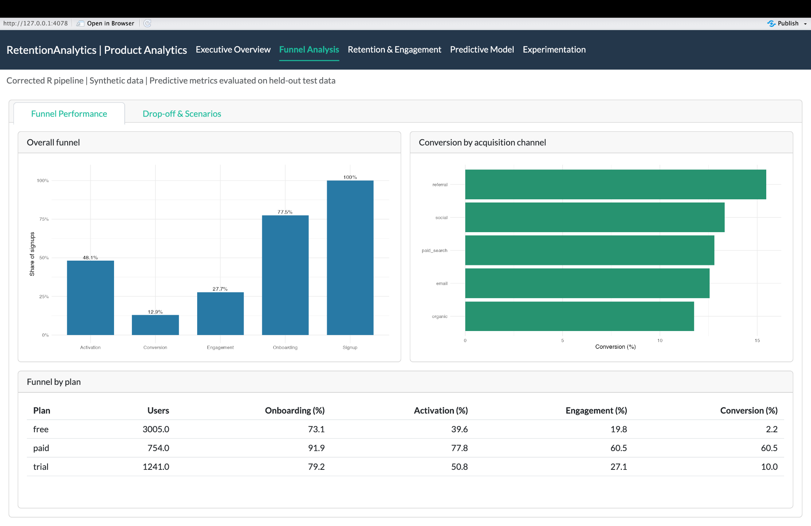
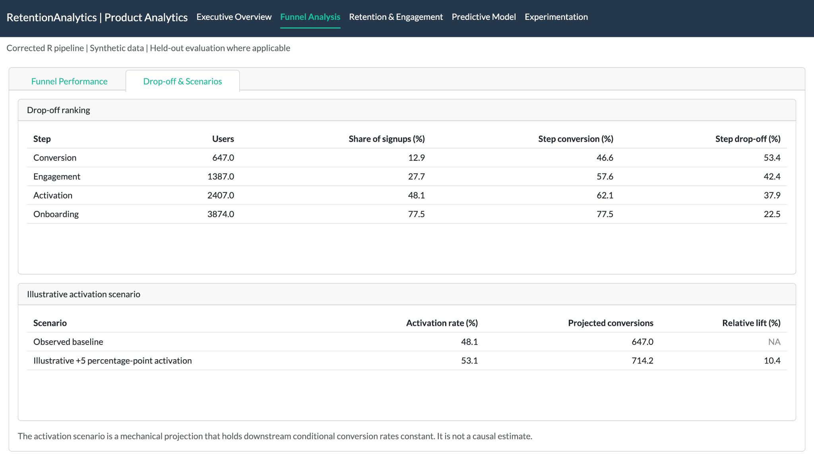
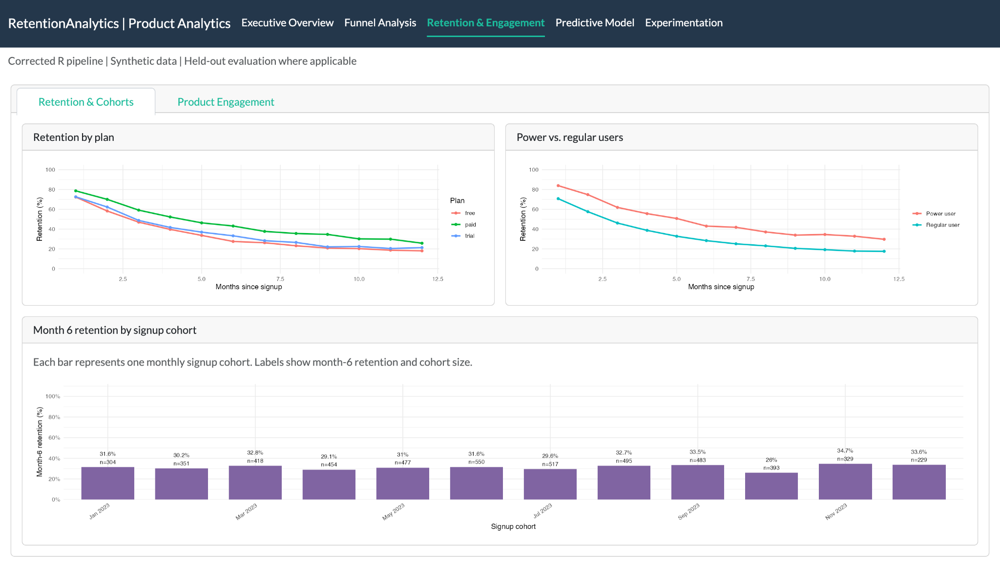
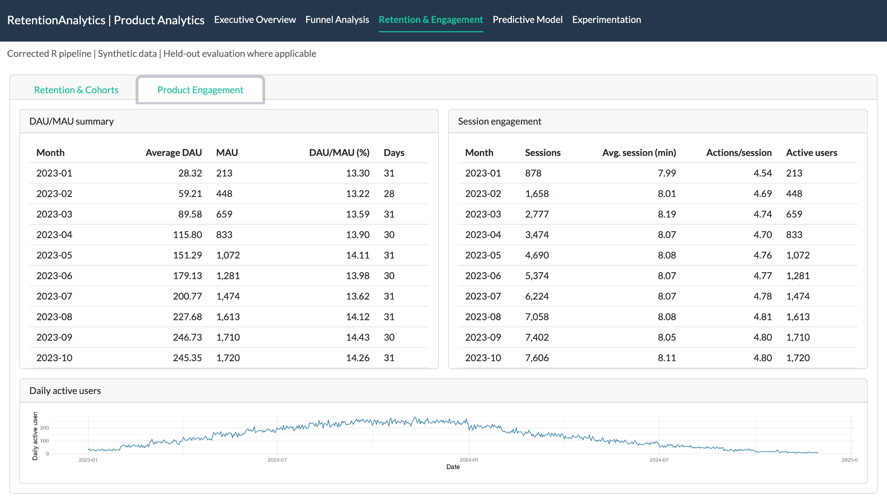
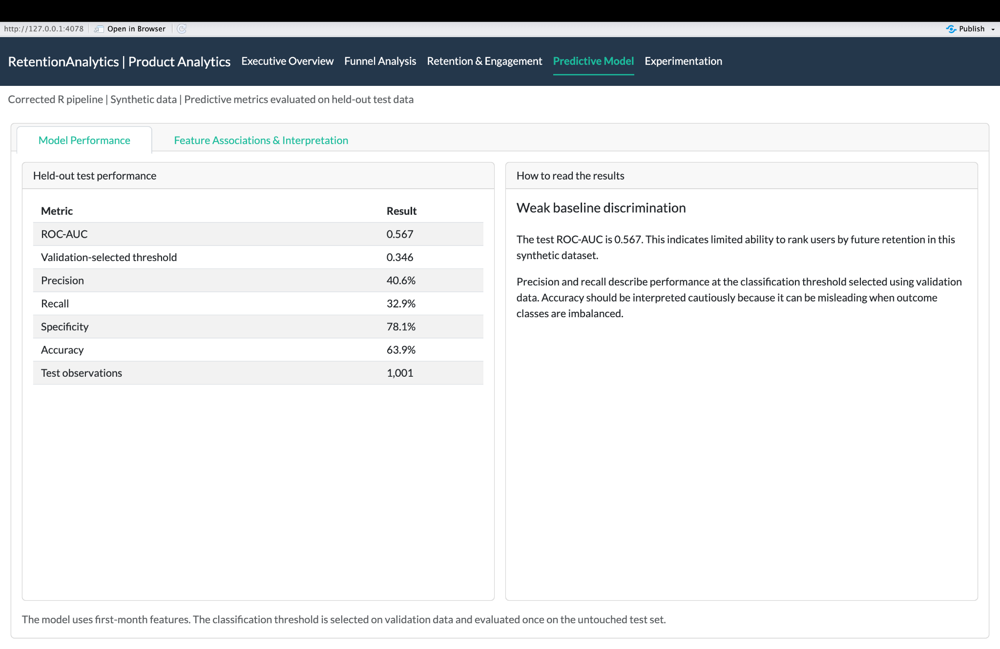
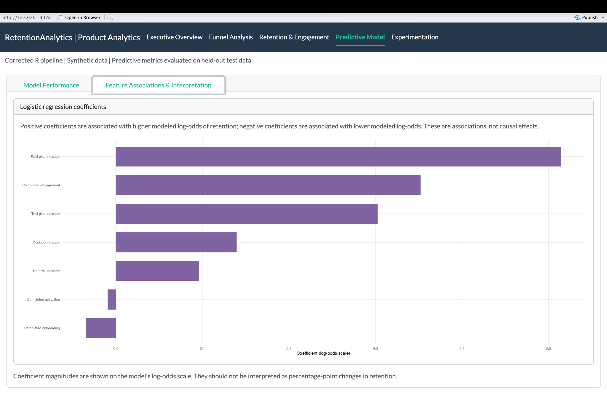
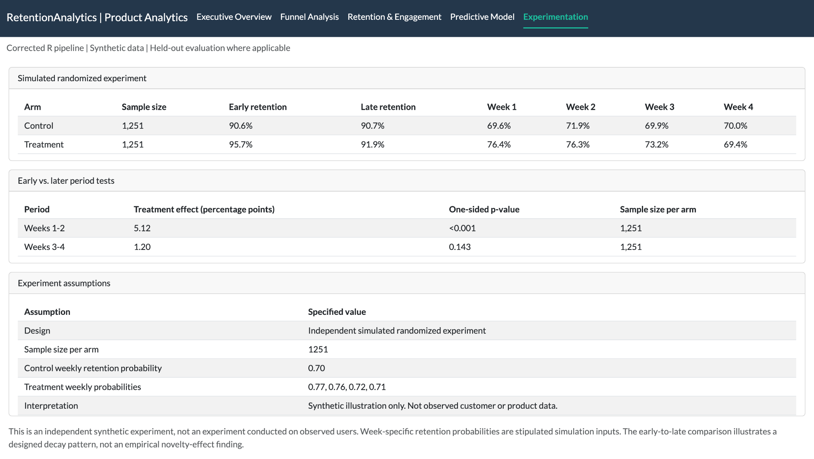

# RetentionAnalytics: Product Retention, Funnel & Experimentation

An end-to-end R portfolio project demonstrating product analytics workflows using a reproducible synthetic dataset. The project covers acquisition and conversion funnels, lifecycle retention, engagement, a baseline retention prediction model, and a separately simulated randomized experiment.

> **Data disclosure:** All user, session, and experiment records are synthetic. The results are illustrative and do not describe a real product, customer population, or production system.

## Dashboard

The interactive Shiny dashboard is organized into five sections:

1. **Executive Overview:** headline product metrics, conversion funnel, and overall retention curve.
2. **Funnel Analysis:** *Funnel Performance* covers the overall funnel, acquisition-channel conversion, and plan comparisons. *Drop-off & Scenarios* covers step-level drop-off and a clearly labeled mechanical activation projection.
3. **Retention & Engagement:** *Retention & Cohorts* covers retention curves by plan and user segment plus month-6 cohort comparisons. *Product Engagement* covers DAU/MAU, session engagement, and daily active users.
4. **Predictive Model:** *Model Performance* presents held-out test metrics and interpretation. *Feature Associations & Interpretation* presents logistic-regression coefficients with guidance on their log-odds scale.
5. **Experimentation:** results from an independent simulated randomized experiment, early-versus-later period tests, and explicit simulation assumptions.

### Dashboard gallery

Screenshots are provided below to make the dashboard reviewable without running the app.

| Dashboard section | Screenshot |
|---|---|
| Executive Overview |  |
| Funnel Analysis - Funnel Performance |  |
| Funnel Analysis - Drop-off & Scenarios |  |
| Retention & Engagement - Retention & Cohorts |  |
| Retention & Engagement - Product Engagement |  |
| Predictive Model - Model Performance |  |
| Predictive Model - Feature Associations |  |
| Experimentation |  |


## Current corrected results

The corrected pipeline uses 5,000 synthetic users. The latest run reported 92,072 session events, 31.26% overall month-6 retention, and 12.9% signup-to-conversion.

| Analysis | Result | Interpretation |
|---|---:|---|
| Users | 5,000 | Synthetic lifecycle cohort |
| Session events | 92,072 | Generated conditional on monthly active status |
| Signup-to-conversion | 12.9% | Share of signups reaching conversion |
| Month-6 retention | 31.26% | Share active in month 6 |
| Retention model test ROC-AUC | 0.567 | Weak discrimination, modestly above chance |
| Model test observations | 1,001 | Held-out test partition |

The model's displayed held-out metrics are precision 0.406, recall 0.329, specificity 0.781, and accuracy 0.639 at a threshold selected on validation data. These are baseline results, not evidence of a production-ready churn or retention model.

The simulated experiment uses 1,251 observations per arm. The observed treatment-minus-control difference is 5.116 percentage points in weeks 1-2 (one-sided p-value <0.001) and 1.199 percentage points in weeks 3-4 (one-sided p-value 0.143). The weekly probabilities are stipulated simulation inputs. The early/late comparison illustrates a decaying simulated treatment effect; it is not an empirical novelty-effect finding.

## What the project demonstrates

- Sequential funnel construction and segment-level conversion analysis.
- Month-since-signup retention curves and signup-cohort comparisons.
- DAU, MAU, DAU/MAU stickiness, and session engagement.
- A leakage-aware month-6 retention prediction workflow with train, validation, and held-out test partitions.
- A separate simulated randomized experiment with explicit assumptions and period-specific analysis.
- An interactive Shiny dashboard and reproducible Quarto report.

## Corrected pipeline and repository structure

The original implementation is retained at the repository root for historical reference. The audited implementation is kept separately in `corrected_r/`.

```
corrected_r/
  scripts/
    01_simulate_data.R
    02_funnel_analysis.R
    03_retention_cohorts.R
    04_predictive_model.R
  data/       # generated locally, not committed
  outputs/    # generated locally, not committed
shiny/
  app.R
retentionanalytics_report.qmd
docs/
  screenshots/ # dashboard screenshots captured after running the app
```

### Methodological decisions

- Session events are generated only during a user's simulated active retention months. This links lifecycle retention and activity data.
- Funnel steps are sequential. A user cannot complete a later step without completing the preceding step.
- Retention is indexed by months since signup, not calendar month.
- DAU uses a complete daily calendar, including zero-session days. MAU is the distinct active-user count within each calendar month.
- The retention model uses first-month behavioral and profile features. The month-6 target is excluded from predictors. Threshold selection occurs on validation data; final metrics are computed on a held-out test set.
- The A/B experiment is a separate synthetic randomized experiment. Week-level outcomes are simulated under stated probabilities. The early/late comparison is an illustration of a stipulated decaying treatment effect, not a measured novelty effect.
- The activation scenario is a mechanical projection that holds downstream conditional rates constant. It is not a causal estimate.

## Reproduce

Run these commands from the repository root in a clean R session:

```r
install.packages(c("tidyverse", "pROC", "shiny", "bslib", "bsicons", "scales"))

source("corrected_r/scripts/01_simulate_data.R")
source("corrected_r/scripts/02_funnel_analysis.R")
source("corrected_r/scripts/03_retention_cohorts.R")
source("corrected_r/scripts/04_predictive_model.R")

shiny::runApp("shiny/")
quarto::quarto_render("retentionanalytics_report.qmd")
```

The scripts write generated data to `corrected_r/data/` and analysis outputs to `corrected_r/outputs/`. These generated files are intentionally excluded from version control. Run the pipeline in order before launching the dashboard or rendering the report.

## Limitations

- The data-generating process is designed for demonstration and is not calibrated to a real product.
- Retention is simulated at monthly intervals. Session activity is simulated at daily intervals conditional on monthly active status.
- The predictive model is a baseline logistic regression with weak held-out discrimination. It is not a production retention model.
- The A/B experiment is independent of the 5,000-user lifecycle dataset and uses assumed weekly probabilities.
- The activation scenario is a mechanical projection, not an intervention-effect estimate.
- Revenue, customer lifetime value, acquisition cost, and unit economics are not modeled.

## Author

Ludovic Njiosseu | MS Statistics, NYU | Statistician and Data Scientist
